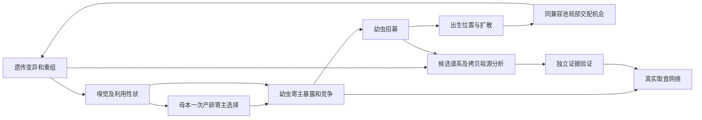

# 模型、假设与寄主分化理论

现行模型0.1.11：`shared-chemical-1`、`slim-qtl-5`、`expression-tuning-2` 和 `resource-coupled-plants-larval-recruitment-1`，遗传引擎为SLiM 5.2。植物跨昆虫代存活，昆虫仍为非重叠代；这里的数值是理论参考，不是已校准的自然系统。输入及参数见[parameters.md](parameters.md)，输出定义见[results.md](results.md)；实际验收进展见[项目入口](../README.md#current-work)。

[v0.1.6 原合同](../codex/history/context_cleanup_2026-11-04/docs/history/model_v0.1.6.md)作为历史文档保留，旧数据按其保存的版本、输入及协议解释。旧协议的源码和输入按需在 `codex/history/` 追溯，当前入口只执行上述协议；本版没有花期状态，也没有交配前寄主定居或相应开关。历史实施和文献报告保存其当时的判断，不代替本文现行定义。

## 1. 研究目标、对象与时间

模型连接三个原研究问题，但机制存在不等于结论已成立：

| 研究问题 | 本模型可表示 | 单靠这些机制不能证明 |
| --- | --- | --- |
| 功能性状如何共同演化 | 双方可遗传性状影响选择、资源交换及繁殖，形成双向生态反馈 | 两方已发生互相适应、共同适应或稳定共演化；须另行设计可区分的比较 |
| 寄主关系如何形成、专化与转换 | 母体产卵选择、子代利用、竞争、出生地扩散及局部交配；可观察使用和遗传组成变化 | 使用变化本身就是遗传适应或生殖隔离；也未建交配前寄主定居 |
| 网络与多样性如何演化 | 实际消费、出生、补充与只读操作谱系的出现、分裂、融合和终止 | 操作群等同生物物种，或固定兼容池之间的先验隔离是新产生的隔离 |

植物和昆虫都是显式二倍体个体。植物类型是母系初始来源标签，不表示生殖隔离或固定后代性状；全局其他幸存植物均可作父本，不按类型或距离限制。昆虫雌雄异体，配偶须属于同一预设昆虫兼容池。模型不自动生成物种、迁入或种子库；标签和操作谱系不是物种确证。默认十类型机制对照关闭双方新突变，选择与重组仍可改变基因型和性状；进化速率从输出估计，不设置植物或昆虫进化速度参数。

二维网格边界周期闭合，格点长度为抽象斑块，每格有`m=microsites_per_cell`个由所有植物类型共享的建立位点；默认m=3，多株只能在m允许时同格共存。创始位置在有限位点中无放回抽取，显式位置超过局部位点数时报错，不自动删株。网格尺寸为 `L=(L₁,L₂)` 时，周期切比雪夫距离为

\[
d_\infty(z,y)=\max_{a=1,2}\min(|z_a-y_a|,L_a-|z_a-y_a|).
\]

一轮`t`是一个昆虫世代，固定`Δ=1`，不是一年或一个植物世代。顺序为：

1. `Adult(t)` 在既有成年位置形成局部异性配偶池；合格雌虫抽潜在卵，每卵在局部候选植物中选择或拒绝，成功卵各从既定池抽父本并形成二倍体子代。
2. 本轮出生幼虫用**自身**基因型产生的处理能力，在出生寄主上同时竞争资源；每只依实际摄入抽一次存活。幸存者从出生寄主格扩散，成为 `Adult(t+1)`。
3. 从植物可食存量扣除消费，根据食后资源亏损抽植物存活；幼虫存活独立抽样。
4. 每个幸存母株按食后资源和表达成本抽扩散提案；提案在幸存株留下的空位中抽签。幸存旧株恢复资源，新株以0.25K建立，下一轮即可参与繁殖。没有一年生/多年生分类、年度、花期、繁殖脉冲或幼年年龄状态。

每格位点只限制建立，不模拟同格植物共享光、水或养分。

## 2. 遗传坐标和传递

### 2.1 原发性状及映射

植物原发坐标为 `x=(x_N,x_S,x_V)`，分别代表非挥发防御、共享防御/挥发功能和独立挥发功能的归一化合成投入。昆虫原发坐标按实现顺序为

\[
(E^I_1,E^I_2,\mu^I_1,\mu^I_2,
  E^A_1,E^A_2,\mu^A_1,\mu^A_2).
\]

上标 `I` 表示处理模块，`A` 表示感觉模块；每类各两个固定模块，`E` 为有效表达/容量或感觉增益，`μ` 为调谐中心。这是八个性状坐标而不是八个真实基因，处理能力 `I` 和感觉参考谱 `A` 是后述派生量，不是直接遗传坐标。

对个体 `i` 的原发坐标 `a`，令 `b_{ka}` 为类群 `k` 的背景、`s_e` 为效应缩放、`e_{a_{ih\ell},a}` 为第 `ℓ` 位点第 `h` 份等位拷贝的该坐标效应：

\[
Z^{raw}_{ia}=b_{ka}+s_e\sum_{\ell=1}^{L_k}\sum_{h=0}^{1}
 e_{a_{ih\ell},a},\qquad
Z_{ia}=\operatorname{clip}_{[l,u]}(Z^{raw}_{ia}).
\]

背景、效应、`s_e` 及边界由输入配置指定；边界位于 `[0,1]`，默认使用该整个区间。性状和等位效应是归一化模型单位，后者可为负；没有显性、上位性或分子调控网络。原发坐标截断不等于将派生的 `I/A` 再截断。创始两份拷贝按各池、各位点输入频率独立抽样，有限样本不必恰等于频率期望；初始参数不等于已经演化出的适应。

当前 `inputs/current/` 是可检验防御作用的理论创始参考：固定原植物分布、调谐中心、核和站立方差，对P1参考反解处理表达中心，使其名义中心满足 `I=(.35,.55)=D`。构造与饱和对照见[参数 G1](parameters.md#g1)；这是阈值附近的机制设计，不是自然祖先估计或按种群存续拟合。表达改变也会降低原成本函数中的处理费用，因此新旧真实轨迹的差异同时包含利用率和母源产出的改变，不能全部归因于防御选择。

默认每轴两个 QTL，植物共六个位点、昆虫共十六个位点。同轴两个标记位于同一抽象连锁群的 0 与 10 cM，不同轴的群独立。植物和昆虫每个成功子代由 SLiM 原生双亲减数分裂各得一份配子；群内相邻标记间距 `d` 以 Morgan 计，使用 Haldane 无干扰标记重组分数

\[
r(d)=\frac{1-e^{-2d}}2,\qquad d=(\Delta\mathrm{cM})/100.
\]

Eidos QTL 核在启用突变时，以每出生后代每位点每份传递拷贝的配置概率 `m_ℓ` 产生新的等位 ID，并按输入的目标坐标正态增量改变效应；旧等位不被改写。若各拷贝独立，则至少一次突变的概率为 `1−∏ℓ(1−m_ℓ)²`；各位点同概率 `m` 时是 `1−(1−m)^(2L_k)`。这些标记和突变率不是 DNA 序列、物理长度或核苷酸突变率。SLiM 支持双亲遗传的实现，不验证下述生态函数。[G1]

### 2.2 植物化学输出

对每株植物

\[
D=(D_1,D_2)=(x_N,x_S),\qquad
V=(V_1,V_2)=(\eta x_S,x_V),\qquad 0\le\eta\le1.
\]

`D` 是防御强度，`V` 是产卵感觉线索强度，均为 `[0,1]` 中的无量纲归一化坐标；`η=eta_shared` 固定且不随个体演化。`x_S` 的两种输出共享一个合成投入，`x_V` 不在本模型直接进入取食防御。这不是说真实 VOC 没有毒性。窗口内假设状态恒定，释放消耗可忽略或由合成补足；不模拟诱导、储存、传输或化学反应通量。

两个输出各有两个位置，处理与感觉模块都使用固定特征坐标 `z₁,z₂∈[0,1]`，但 `D₁=x_N`、`D₂=x_S` 而 `V₁=ηx_S`、`V₂=x_V`。同一 `k` 在两个向量中只是各自的抽象索引；尤其共享投入 `x_S` 对应 `D₂` 与 `V₁`，不能据此把 `D_k` 和 `V_k` 解释为同一种真实化合物。三轴划分与固定线性耦合是项目情景，实验上共享前体也可以有独立调控分支。[C1,C2]

### 2.3 昆虫处理与感觉模块

设 `k∈{1,2}` 为固定目录位置，`r∈{1,2}` 为模块。调谐核、处理容量及未饱和感觉参考谱为

\[
T^{I,A}_{irk}=\exp\!\left[-\frac{(z_k-\mu^{I,A}_{ir})^2}
 {2w_{I,A}^2}\right],\quad
P^I_{irk}=\frac{T^I_{irk}}{a_0+\sum_{j=1}^2 T^I_{irj}},
\]
\[
I_{ik}=\sum_{r=1}^{2}E^I_{ir}P^I_{irk},\qquad
A_{ik}=\sum_{r=1}^{2}E^A_{ir}T^A_{irk}.
\]

`w_I,w_A>0` 是固定宽度，与 `z,μ` 同为无量纲特征坐标；`a₀=processing_idle>0` 是无量纲闲置通道。处理分母始终覆盖完整固定目录，即使某株植物相应底物为零也不重新分配，因此 `Σ_k I_ik≤Σ_r E^I_ir`，未匹配容量可以闲置。`I` 是归一化有效处理能力，`A` 是无价性、未饱和的表达加权参考谱；它们不保证属于 `[0,1]`。这是一种固定预算近似，不是实测多底物酶动力学，也不模拟模块复制、可遗传宽度或真实受体和酶家族。[F1,F2]

## 3. 产卵线索与选择

对雌成虫 `i`、其第 `e` 枚卵的候选集合 `H_{ie}`、候选植物 `p` 和感觉模块 `r`，感知输入、效用及在候选集合内的概率为

\[
a_{ipr}=\sum_{k=1}^{2}V^{cue}_{pk}T^A_{irk},\quad
u_{ip}=b+\sum_{r=1}^{2}v_r E^A_{ir}
 \frac{a_{ipr}}{h_A+a_{ipr}},
\]
\[
\Pr(p\mid H_{ie})=
\frac{\exp(\tau u_{ip})}
 {\exp(u_0)+\sum_{q\in H_{ie}}\exp(\tau u_{iq})},\qquad
\Pr(\mathrm{reject}\mid H_{ie})=
\frac{\exp(u_0)}
 {\exp(u_0)+\sum_{q\in H_{ie}}\exp(\tau u_{iq})}.
\]

`h_A=sensory_half>0` 与 `V` 使用同一归一化输入标度；`b,u,v_r,u₀` 与 `τ` 均按无量纲效用及概率标度使用，`τ≥0`，拒绝项 `u₀` 不乘 `τ`。`v_r` 是固定正或负的行为价性，`E^A` 在饱和之后改变增益而非半饱和阈值；负读出不是受体抑制的生理模型。固定高斯核、饱和函数、价性和 softmax 均是项目假设，不由感觉谱或寻主研究直接验证。[F1,F3]

价性允许任意两个有限实数，包括同号或零，默认一正一负不是输入必备条件。默认 `b=1, v=(1,−1), E^A∈[0,1]` 给出 `u≥0`；配合 `τ=1,u₀=0`，非空候选集的拒绝概率不超过 `1/(1+|H|)`，八候选时不超过 `1/9`。这限制了本默认设计的绝对拒斥，但负模块仍能使某候选相对较少被选。一般是否低于拒绝项须比较 `τu` 与 `u₀`，不能只比较 `u` 与零；改变 `b`、价性幅度或拒绝效用可以定义不同理论对照。

每枚潜在卵以母体成年位置为中心，在 `search_radius` 内植物中无放回均匀抽至多 `candidate_size` 株；同一候选植物不会因被选过而从后续卵的池中消失。无候选或拒绝时不出生、不消费资源。强制选择移除拒绝项；中性感觉令所有候选 `u=b`，但是否允许拒绝仍取决于选择模式。`A` 只是参考谱，实际效用读取母体自己的表达、调谐和固定价性；母体不读取或预知未出生子代的 `I`，偏好与子代表现可以错配。

一般 `V^{cue}=V`；`shuffle_voc` 对本轮植物线索向量作一次置换，供该轮逐卵选择使用，不改变植物本身的 `D`、`V`、成本、资源或成虫配偶池。置换使用独立阶段8随机流，开关不会额外消耗阶段1的选择顺序流；处理使行为和后续种群分岔后，不保证整条轨迹的各次抽样仍逐个体配对。没有远距离气味扩散与定向搜寻。

## 4. 防御、资源与存活

### 4.1 取食利用上限

出生于植物 `p` 的幼虫 `i`，以自身派生处理能力 `I_i` 与该株防御 `D_p` 计算

\[
q_{ip}=\min\!\left\{1,\min_{k:D_{pk}>0}
 \frac{I_{ik}}{D_{pk}}\right\},\qquad d_i=d_i^{max}q_{ip}.
\]

`q∈[0,1]` 是无限资源条件下的**有效取食利用上限**；`D_k=0` 的通道不限制，所有 `D_k=0` 时定义 `q=1`。`d_i^{max}>0` 是一个幼虫在一代取食窗口内的最大需求，`d_i` 是受防御限制后的实际资源需求。

若全部可达组合的 `I_k≥D_k`，`q` 恒为1，防御在该范围内不能经利用率改变消费或幼虫存活；提高资源容量不能解除这一截断。旧创始处理表达中心均为`.8`，其15,625个相关表型组合全部饱和，最小未截断 `I/D≈1.11352`；该旧输入保留其历史身份，不可用新参考值重解释旧结果。饱和仍可作为合法的中性对照，不对所有运行强制要求 `q<1`。

这里防御通过降低 `q` 抑制可利用取食，继而经资源分配改变摄入与摄入相关存活；不额外设置独立的毒性死亡。`I/D` 的最限制通道有理论模型先例，但并非真实酶动力学、毒物剂量或代谢产物无毒的实证结论。[C5]

### 4.2 同批分配和食害

设`P(i)`为幼虫出生寄主，`K_p>0`为配置中的最大可食叶量，`B_{p,t}∈[0,K_p]`为本轮开始的可食存量。创始株`B=K`；存活旧株不再每轮重置为K。现有资源分配核中的`R_p`读取`B_{p,t}`，`T_p`为同批幼虫总需求：

\[
T_p=\sum_{i:\,P(i)=p}d_i,\quad
\gamma_p=\begin{cases}1,&T_p=0,\\
\min(1,R_p/T_p),&T_p>0,\end{cases}
\quad x_i=\gamma_p d_i,
\]
\[
X_p=\sum_{i:\,P(i)=p}x_i=\min(T_p,R_p),\qquad
g_i=\frac{x_i}{d_i^{max}},\qquad
h_p=\begin{cases}X_p/R_p,&R_p>0,\\0,&R_p=0.\end{cases}
\]

`K,B,R,d^{max},d,T,x,X`使用相同可食干生物量单位；`g,h,γ`无量纲。`h=X/B_{start}`是**当轮现有资源被消费的比例**，`B_start=0`时定义h=0、幼虫g=0，但这不代表植物没有叶量亏损。植物死亡另用`δ=1−B_post/K`，不能混淆两个分母。所有幼虫按需求比例同时分享，不设先到先得、独立干扰竞争或额外密度乘子。

资源工作值、对照情景及其证据统一见[参数 R1](parameters.md#r1)。

在处理能力和其他条件固定时，增加某一防御坐标可降低相应幼虫 `q`，但当轮消费比例 `h` 不必随之下降：只要 `R_p>0` 且降低后的总需求仍满足 `T_p≥R_p`，资源仍被耗尽，`h_p=1`。这是共享有限资源及消费比例定义的直接结果；只有总需求降至容量以下后，`X_p` 与 `h_p` 才随总需求下降。竞争者之间的实际分配也可能变化，因此不能把 `q` 变化直接等同于每只幼虫摄入或存活变化。

同株补充数 `N_p=Σ_iY_i^H` 的条件期望为

\[
\mathbb E[N_p]=\gamma_p\sum_iq_{ip}
=\min\!\left(\sum_iq_{ip},\frac{R_p\sum_iq_{ip}}{\sum_i d_i^{max}q_{ip}}\right)
\]

其中总需求为零时期望为零，同dmax时为`min(Σq,B_start/dmax)`。当前多虫参考K=10、dmax=1，只有满资源时受限期望才为10，食后未完全恢复时更低。它不是实际补充数的硬截断；独立抽样仍可能补充更多。异质dmax时受限值随利用率和需求组成而变。

即使资源仍耗尽，防御也可改变异质幼虫之间的份额。例如 `R=dmax=1`、两幼虫 `I=((1,1),(.4,1))`，`D` 从 `(.3,.5)` 变为 `(1,1)` 后，`g` 从 `(.5,.5)` 变为 `(5/7,2/7)`，而 `h` 始终1。仅由幼虫数达到2不能推出 `g` 与防御无关。

启动元数据的 `founder_feeding_diagnostics` 只读检查**实际抽到的创始成虫与植物的全部配对**，报告 `q` 分布、两防御轴截断于`[0,1]`的±`1e−4`有限差分敏感比例，以及单幼虫独占每株时 `g=min(q,R/dmax)` 的敏感和资源屏蔽比例；响应差异容差为`1e−12`。该探针不执行候选相遇、产卵或同株拥挤，不是实际幼虫比例。真实同轮作用仍须按账本中的 `q,T,R,g,h` 及份额判断，单凭初代覆盖不能证明后续双向选择。

### 4.3 存活和母源成本

\[
S_{P,p}=\exp[-\Delta(\mu_{0,s(p)}+\mu_{D,s(p)}\delta_{p,t})],\qquad
S_{H,i}=g_i,\qquad \mu_0,\mu_D\ge0,
\]
\[
C_{P,p}=c_D(x_{N,p}+x_{S,p})+c_Vx_{V,p},\quad
F^P_{m,p}=\max(0,1-C_{P,p})B^{post}_{p,t}/K_p,
\]
\[
C_{H,i}=c_I\sum_{r=1}^{2}E^I_{ir}+c_A\sum_{r=1}^{2}E^A_{ir},
\quad F^H_{m,i}=\max(0,1-C_{H,i}).
\]

`S` 为存活概率，`F_m` 为母源产出乘子，`c_D,c_V,c_I,c_A` 为非负的相应归一化投入单位的倒数；`c_A=sensory_cost`，`c_I=insect_cost`。植物共享投入 `x_S` 只支付一次基本成本，`η` 不直接增加成本；昆虫成本按母体自己的两类表达收费，不按派生 `ΣI` 收费。成本只折减母源产出，不另降低存活，也不剥夺昆虫父源资格；它不是闭合的跨性别、跨生命阶段能量预算。

每只幼虫仅抽一次`Y_i^H∼Bernoulli(g_i)`，无额外毒性死亡或幼虫存活底值；`S_H=g`是理论闭合。植物危害率`μ₀,μ_D≥0`的单位为每昆虫代，背景与叶量亏损共同决定存活。旧`sP0`和线性植物存活式退役；表达成本只在植物每轮的母源产量上收费，不再乘入植物存活。

当前各植物类型共用同一组危害率与恢复率，均为固定情景参数，不是QTL决定的可遗传耐受或成熟性状。

给定本轮资源状态，植物存活与各幼虫存活分别抽样；**寄主在本轮植物存活抽样中死亡，不再连带杀死已完成该取食窗口的幼虫**。因此死亡寄主上的幼虫仍可正常补充为成虫。该时间窗口假设省略取食中途寄主死亡导致的额外幼虫损失，也不表示死亡寄主幼虫拥有与任何活主幼虫相同的总适合度；它们的`g`仍由各自摄入决定。食害对植物繁殖、后续寄主数量及后续产卵机会的反馈仍在。

### 4.4 资源亏损与恢复

令K为最大可食资源，B为轮初存量、X为本轮消费。食后 `B_post=B−X`，亏损 `δ=1−B_post/K`；不再保存同龄无取食参照。无虫新株也可能因B低于K而有亏损，这是本简化模型的假设，不是实测幼株风险。

每株按 `S=exp(−μ₀−μD δ)` 抽一次存活。幸存株恢复至 `B_next=K−(K−B_post)exp(−r)`；死亡株残余移出，新株初始B=0.25K。恢复和新株资源是账面输入，该模型不追踪全株碳收支、光水养分或储备。

## 5. 相遇、繁殖与扩散

### 5.1 昆虫潜在卵

成虫上一轮已通过幼虫存活，本轮不再抽成虫存活。雌成虫 `m` 的父本池由其成年坐标、`insect_mate_radius` 内同兼容池雄虫决定；没有父本时不产生潜在卵。对非空池：

\[
\nu_m^{egg}=\lambda_{egg,s(m)}F^H_{m,m},\qquad
E_m\sim\operatorname{Poisson}(\nu_m^{egg}).
\]

`λ_egg` 是每个合格雌成虫每代潜在卵的基准均值，不是存活补充均值；不再乘母亲上一轮幼虫摄入。每枚成功卵从同一父本池均匀、有放回地抽一位雄虫，随后发生双亲遗传；同母后代可以异父。接受概率若为 `a_m`，在给定母体、植物及本轮 `V_cue` 状态下出生均值为 `ν_m^{egg}a_m`，补充还依赖子代遗传和同批竞争。成年雄虫不因自身母源表达成本失去父源资格。

创始和子代性别分别按配置的雌性概率独立抽样，`sex=0` 为雌、`sex=1` 为雄；不模拟性染色体。没有花粉或精子耗竭、额外择偶偏好或储精。

### 5.2 植物繁殖及空位建立

每轮幸存母株以 `F_P=max(0,1−C_P) B_post/K`，抽取 `Poisson(λ_P F_P)` 个扩散提案。λP=2是每轮理论基准，不能等同旧版每5轮的2；父本从全局其他幸存株中均匀随机抽取，不按距离或初始类型限制；孤株无父本则无提案。提案按扩散核到达目标格，在幸存株留下的空位中均匀抽签；未建立的提案不产生新株。已建立新株由双亲SLiM遗传，性状由重组及启用时的突变产生；初始来源标签随母本。新株当轮不再连锁繁殖，`N_next=N_retained+N_established`。

### 5.3 扩散及阶段贡献

植物建立提案以母株格为起点，幸存昆虫以出生寄主格为起点；每轴独立均匀抽整数位移，周期取模。已存在植物留在原格，不再每轮扩散。各类扩散、搜寻和昆虫交配半径分开设置。

均匀的是整数位移，不保证周期折叠后的目的格均匀。某轴有`2r+1`个允许位移时，每个残余格的重数只能是 `floor((2r+1)/L)` 或 `ceil((2r+1)/L)`，最多相差1；二维概率为两轴重数乘积。大半径下的重复落点符合此位移核，不能解释为三角形扩散核或自动改为目的格均匀采样。

昆虫出生和补充阶段与植物已建立新株均以母父各半计贡献。植物旧株留存另计，不是新生贡献。零后代时归一化频率未定义。整轮检查成功才提交账本；计算保护停止不等于生态灭绝。

## 6. 观察量、寄主背景与网络

固定参考面板使用独立 reference IDs，不决定祖先兼容池数量或创造新寄主。`reference_p` 是排除拒绝项后在参考面板内的条件相对选择概率；`reference_q` 是无限资源利用上限，不是绝对产卵接受或实际消费。参考观察不产生真实子代或改变模拟状态。逐个体响应宽度不等于群体平均响应宽度，全零 `q` 的归一化宽度未定义。

出生寄主背景按每个成年个体的真实出生植物类型分类，创始 `unknown` 保留。对于昆虫出生或补充阶段 `K`，若 `H(o)` 为子代 `o` 的出生寄主池，双亲来源到子代寄主背景的权重为

\[
G^K_{ab,t}=\sum_{o\in K}
 1[H(o)=b]\,\frac{1[H(m_o)=a]+1[H(f_o)=a]}2.
\]

其总和为该阶段后代数，包含 `unknown`；双亲各自的出生背景和子代的出生寄主可以不同。这是模型内双亲来源计数，不是直接估计的有效基因流率、迁移率或隔离程度。

实际资源网络使用幼虫的 `x_i`，补充网络使用幸存子代的出生寄主，滞后网络以本轮双亲自身的出生背景记录贡献。操作谱系网络的 `maternal_source` 把母体 `t` 群连接到植物 `t` 群，记录其后代的实际消费、出生和补充，并不把幼虫遗传成员身份等同母体；`recruit_cluster` 把 `t+1` 幸存补充群连接到 `t` 出生寄主群，只记补充数，避免重记消费。`unknown/unassigned` 必须保留以维持总账。

### 6.1 只读操作谱系

对同一兼容池内两个个体 `i,j` 的有限 QTL，令 `a_{ihℓ}` 为第 `ℓ` 位点的等位 ID，则无相位拷贝不匹配距离为

\[
d_{ij}=1-\frac1{2L_k}\sum_{\ell=1}^{L_k}
\max\!\left(
 \sum_{h=0}^{1}1[a_{ih\ell}=a_{jh\ell}],
 \sum_{h=0}^{1}1[a_{ih\ell}=a_{j,1-h,\ell}]
\right).
\]

距离不超过观察阈值的个体连边，连通分量达到最小群大小才被分类；其余为 `unassigned`。双亲跨代补充关系用于标记起源、持续、分裂、融合与终止；连续代数在分裂或融合时重新计算。阈值、最小群大小和持续代数都是只读观察参数，不反向改变配偶、生态或遗传。

植物另以同ID的旧株留存维持观察群连续性；`retained_individuals`与新生遗传贡献分列。群体跨轮持续可以完全来自旧株存活，不能据此声称发生了新有性交配、遗传流动或形成生殖隔离。

等位 ID 相异不等于 DNA 序列距离；有限 QTL 不能覆盖全基因组，单个桥接基因型即可合并连通分量。候选持续群、同池内偶然空间隔离或预设池间不可交配都不自动构成新生物物种或形成隔离的证据。与自然群体中的寄主相关分化相比，还需要独立的遗传、相遇与隔离证据。[D1,D2]

## 7. 文献支持与未解决边界

以下为已有核实文献的支持层次；它们不共同证明本文所有函数、参数或完整生活史：

- **[C1]** Zhou & Jander (2022), [植物挥发物综述](https://doi.org/10.1093/jxb/erab413)，以及 Hopkins et al. (2009), [植物防御与昆虫关系综述](https://doi.org/10.1146/annurev.ento.54.110807.090623)：提供化学功能背景，不证明三轴、固定线性映射或 `η`。
- **[C2]** Frey et al. (2000), [玉米诱导挥发与防御途径](https://doi.org/10.1073/pnas.260499897)：支持共享背景下分支可独立调控，不给出本模型组成型耦合系数。
- **[C5]** Speed et al. (2015), [植物防御多样性的理论模型](https://doi.org/10.1111/nph.13560)：为瓶颈与成本提供理论先例；本模型的零防御约定、有限资源、`S_H=g` 和昆虫双亲生活史是扩展，不是逐式复现。
- **[F1]** Hallem & Carlson (2006), [受体组合响应](https://doi.org/10.1016/j.cell.2006.01.050)，以及 Li et al. (2003), [昆虫酶的底物范围](https://doi.org/10.1073/pnas.1934643100)：支持区分功能响应谱，不验证固定宽度高斯、容量预算或幼虫净生存。
- **[F2]** Niu et al. (2011), [广食昆虫的底物特异性酶](https://doi.org/10.1016/j.ibmb.2010.12.009)：所测广食昆虫可具有窄底物谱酶，个体广食范围与单模块宽度不可混同。
- **[F3]** Auer et al. (2020), [嗅觉调谐与寄主专化](https://doi.org/10.1038/s41586-020-2073-7)，以及 Bruce et al. (2005), [挥发线索与寄主定位](https://doi.org/10.1016/j.tplants.2005.04.003)：支持遗传调谐与气味线索的相关机制，不验证本版固定价性或逐卵效用。
- **[D1]** Peccoud et al. (2009), [寄主关联分化连续性](https://doi.org/10.1073/pnas.0811117106)：分化可伴随不同程度的交流，不给出本模型的通用物种阈值。
- **[D2]** Dieckmann & Doebeli (1999), [生态与交配机制的理论比较](https://doi.org/10.1038/22521)：展示特定条件下生态分化与交配规则的关系，不证明本模型一定能或不能成种。
- **[G1]** Haller & Messer (2023), [SLiM 方法](https://doi.org/10.1086/723601)：支持模拟框架，不证明具体生态假设或本项目参数。
- **[P1]** [Stam等2019](https://doi.org/10.1111/1365-2745.13231)及[Gols等2018](https://doi.org/10.1007/s00049-018-0258-4)分别研究多年生野生甘蓝的跨季群落/繁殖及化学动态，支持保留同一植株的时间结构，不标定5轮繁殖钟或死亡率。
- **[P2]** [Heichel与Turner1983](https://doi.org/10.1007/BF00379555)人工去叶后再展叶，以及[Barker Plotkin等2021](https://doi.org/10.1111/1365-2435.13891)的舞毒蛾—栎树储碳/死亡研究，支持恢复和持续压力应区别于一次消费；不能把木本阈值或恢复量转成甘蓝参数，更不验证固定容量的一状态近似。
- **[P3]** [Metcalf等2008](https://doi.org/10.1073/pnas.0800777105)的单次结实多年生蓟类研究与[Peng等2012](https://doi.org/10.1093/jpe/rtr041)的空位抽签理论，支持将建立限制与成株生存区别；不证明每格一个位点、重复繁殖或本项目数值。分系统核验层级见[参数](parameters.md)。

更详细的证据读取范围与反例见 [功能文献报告](../codex/history/context_cleanup_2026-11-04/docs/plan/v0.1.7_literature_functions_sol_2026-10-28.md) 和 [分化文献报告](../codex/history/context_cleanup_2026-11-04/docs/plan/v0.1.7_literature_divergence_sol_2026-10-28.md)。它们各自标明全文、摘要或索引片段的核实深度；其中撤回的花期和交配前定居建议不属于当前实现。

尚未解决的是如何针对具体系统估计各功能及人口学参数、检验线性存活与容量分配、区分生态使用变化和遗传适应，以及为潜在新隔离建立独立证据。固定化学目录、固定模块数、单维特征及当前局部均匀配偶限制了可表达的机制；需要其他机制时应先明确科学问题再修订模型，不能以当前输出倒证这些过程。

匹配机会分析使用成年母本及其同兼容池全部雄虫的完整分类共同风险集；局部与全局保持同一母本和权重，只移除空间可达性限制。潜在卵均值、已抽取潜在卵和成功产卵数分别计算，不混合口径；无配偶、分类未知及权重缺失边界见输出账本。固定参考代 QTL 祖源由实际传递的亲本同源拷贝逐位点递推，突变保留来源；参考代份额是基线。出生按出生寄主分组，招募后才按当代候选群分组，后者不能视为固定的未来群身份。

## 8. 适用边界补充

前述公式已经定义生活史、模块、成本、空间和观察规则，以下仅补充解释边界：

- 不包含迁入、种子库或人为补种保底；昆虫严格异交及母源限定成本是条件假设，不代表现实父源成本为零。
- 处理模块和感觉模块是功能类比，不等于真实 P450、OR、神经编码或解毒动力学。检测增强不必代表吸引；化学线性共享不代表实际分子浓度、储量或能量守恒。
- 参数未按自然系统校准；短程存续不能证明长期共存、共同适应或成种。观察群只用于只读分析，不能通过标签、阈值、额外禁配或杂交死亡制造物种。

- [Frey et al. (2000)](https://doi.org/10.1073/pnas.260499897) 的玉米研究显示相关合成功能可参与防御和诱导挥发分支；不能推出本项目固定线性共享映射或 `eta`。植物化学多样性和成本的背景亦见 [Blanchard & Holeski (2024)](https://doi.org/10.1086/727902)，其综述不确定这里的线性系数。

- [Gripenberg et al. (2010)](https://doi.org/10.1111/j.1461-0248.2009.01433.x) 的植食昆虫综合分析报告偏好—表现总体正关联且有例外，不支持把两者设为恒等或完全独立。[Feder et al. (1994)](https://doi.org/10.1073/pnas.91.17.7990) 在果实蝇中发现寄主忠诚可限制交配交流；当前模型不具备该研究所示的寄主场交配通道，出生背景或观察分群不能代替隔离证据。

## 9. 寄主分化、隔离与谱系网络

箭头为可审查的因果假设或分析依赖，并非保证方向。谱系识别与物种验证为只读分析，不反馈行为。

| 来源或参数 | 分类 | 地位与敏感性 |
|---|---|---|
| 同池局部均匀父本抽样、一次产卵选择、幼虫摄入和招募 | 项目现行规则 | 固定基线；交配、扩散半径和资源竞争可预先做敏感性分析 |
| 双亲减数分裂；同轴 0、10 cM、轴间独立 | 项目现行遗传假设 | 非真实染色体；图谱及突变率为预先设定变量 |
| 随机结合下 D′ 经重组乘 (1−r) | 经典理论 | 仅限 C 所列假设；r 为分析变量 |
| 匹配机会空间对照、祖源占比、网络映射 | 项目操作性定义 | 母本权重、分类覆盖、窗口与规模需事先声明 |
| [Nosil 2024](https://doi.org/10.1038/s41467-024-46294-9)、[Linn 2003](https://doi.org/10.1073/pnas.1635049100) | 实证机制 | 空间与气味案例，类群特异 |
| [Linn 2004](https://doi.org/10.1073/pnas.0408255101)、[Eyres 2025](https://doi.org/10.1111/mec.17795) | 实证机制 | 杂交气味响应及蚜虫多 QTL，不等于必有杂交死亡或多效性 |
| [Felsenstein 1981](https://doi.org/10.1111/j.1558-5646.1981.tb04864.x)、[Hawthorne & Via 2001](https://doi.org/10.1038/35091062) | 理论及实证 | 重组障碍和蚜虫连锁案例，不保证本模型成种 |
| [Sobel & Chen 2014](https://doi.org/10.1111/evo.12362)、[Singhal 2025](https://doi.org/10.1146/annurev-ecolsys-102723-055311)、[Maliet 2020](https://doi.org/10.1111/ele.13592) | 方法与理论背景 | 机会校正、独立验证和网络模型；具体指标为本项目定义 |

可模拟并分析寄主暴露、空间机会、实际招募和已记录 QTL 拷贝传递；不能仅由聚类声称物种、全基因组祖源、内源杂交不育或网络稳定性。共同环境与反事实若现有数据不支持，须标记不可估计；持续隔离不足时保留理论缺口。

文献核查范围：Felsenstein 1981、Hawthorne 与 Via 2001、Maliet 等 2020 本次仅核对书目或摘要，未读取全文；其余文献核查相关全文部分。

实施范围：匹配空间机会、固定参考代 QTL 拷贝祖源及网络观察已有最小实现。B 的受控实验执行器、特定杂交队列留存和物种独立性验证仍待实施；当前任务见[项目入口](../README.md#current-work)。

## A｜空间交配机会与交配前隔离

**项目操作性定义。** 在繁殖轮次 t、父本抽取前，按当代可得遗传信息确定互斥候选群 A、B，未知另列；出生寄主 H 是生态标签，不能代替群体身份。每只 A 雌虫 i 的局部集合 Cᵢ 是其交配半径内、同既有兼容池的可用雄虫；全局集合 Uᵢ 是同一兼容池全部可用雄虫，仅移除距离限制，绝不跨池。雄虫按现有规则均匀、有放回抽取。

为保持原抽样分布，选择同一完整分类风险集 I={i∈A: |Cᵢ|>0，且 Uᵢ 全部雄虫身份已知}，令 Cᵢ′=Cᵢ、Uᵢ′=Uᵢ。固定相同母本集合和非负权重 wᵢ，计算；另报告排除的母本及其权重、局部与全局未知雄虫比例。不能分别删掉未知雄虫后各自重新归一。

\[P_L=\frac{\sum_{i\in I}w_i |C_i'\cap B|/|C_i'|}{\sum_{i\in I}w_i},\quad P_G=\frac{\sum_{i\in I}w_i |U_i'\cap B|/|U_i'|}{\sum_{i\in I}w_i},\quad RI=1-P_L/P_G.\]

均为无量纲条件比例，时点是 t 父本抽取前；权重可分别采用母本潜在卵均值（卵/轮次）、实际抽到的潜在卵数（卵）或实际成功产卵数（卵）。实际潜在卵仅在现有局部有配偶时生成，须说明其条件化；成功产卵权重只解释为对成功产卵者的条件效应，不能代表全部雌虫。三种口径不混合，且每个局部/全局比较内使用同一权重。权重和为零、I 为空或 P_G=0 时 RI 为 NA；P_L、P_G 本身分母为零也为 NA。RI 可以为负。无本地候选雄虫及仅有未知身份雄虫各以母本数、可预先定义的潜在繁殖权重占比单独报告：前者是机会损失，不计为群内配对。完整分类筛选改变目标总体，不代表未知个体的交配结构；可补充全体可用雄虫的覆盖率。固定观测权重是静态对照，不能宣称改变空间后生态反馈的总因果效应。B 母本反向指标另算。

例：两个同池雄虫 A、B，各雌局部均能接触两者，则 P_L=P_G=1/2，RI=0。若 A 雌只能接触 A 雄而全局仍各一只，则 P_L=0、P_G=1/2、RI=1；若全局没有 B 雄，P_G=0，RI=NA。均匀植物分布不保证均匀昆虫分布；聚集可增强或减弱局部差异，扩散或交配半径增大通常扩大可达范围，但实际概率取决于空间构型，非单调定律。出生地点和扩散塑造位置，无需第二次寄主选择；这不是性隔离或成种证明。[Nosil 等 2024](https://doi.org/10.1038/s41467-024-46294-9) 区分栖息地与性隔离；[Linn 等 2003](https://doi.org/10.1073/pnas.1635049100) 的果味识别证据针对实蝇。

## B｜共同环境与生态性合子后表现

**项目操作性定义。** 配对方向 X♀×Y♂ 的亲本在交配前按预先确定的群体抽样，现有双亲减数分裂及重组产生后代基因型分布 M(X,Y)。在预先固定的寄主 e、资源量、竞争者组成与密度和测量窗口下，定义 Wₑ(g)=该基因型幼虫从成功产卵至成年招募的条件概率，取值 [0,1]；

\[W_{XY,e}=E_{g\sim M(X,Y)}[W_e(g)].\]

它是无量纲每个成功产卵后代的平均招募概率，分母为该方向在该共同条件下的成功卵数；无卵、无可评估后代或未观测共同环境为 NA。共同环境需要受控试验或明确的反事实计算及支持条件，不能把自然状态下不同竞争直接当作可比结果。模型中的幼虫摄入及存活受其利用性状、植物资源及竞争影响；母本嗅觉影响产卵位置，不是幼虫生存函数。若使用实际产卵到成虫的自然结果，明确另报其寄主暴露分布和分母；无法仅凭观察区分环境与基因型效应。终生遗传贡献是不同终点，不能与招募概率相加。

比较 W_AA,e、W_AB,e、W_BA,e、W_BB,e；方向可通过母本分布和实际暴露不同而非对称。F1 来自 A×B，F2 来自 F1×F1，回交为 F1×A 或 F1×B；均重新定义亲本分布和同一环境，不把它们当同一代。现有函数允许的共同环境反例：固定两处理模块调谐坐标 (0,1)、化学特征 (0,1)、宽度 σ=0.5、idle=1，其余坐标相同。令 ε=exp(−2)、c=2+ε；两亲本纯合的表达分别为 (1,0) 和 (0,1)，以无突变的加性 QTL 构造，使 F1 表达为 (0.5,0.5)，亲本在相关位点纯合，因此相位与重组不改变 F1。亲本群各为对应纯合基因型，四种方向均在相同抽样规则下比较。现有 `modules.effective` 给出亲本处理能力分别为 (1,ε)/c、(ε,1)/c，F1 为 ((1+ε)/(2c),(1+ε)/(2c))。固定植物防御 D=(d,d)、d=(1+ε)/(2c)，孤立幼虫且资源 R≥最大需求，现有 `traits.consumption` 给亲本 q=2ε/(1+ε)≈0.2384、F1 q=1；在现有存活 S=q 的条件下，W_AA=W_BB≈0.2384、W_AB=W_BA=1。表达不触及截断改变，参数是可构造的解析例设，并非默认参数预测或模拟调参。也允许中性或劣势，且 F2 重组后可不同。

**文献支持的机制。** [Linn 等 2004](https://doi.org/10.1073/pnas.0408255101) 报告实蝇杂交后代对亲本果味响应下降，不能直接证明存活或繁殖下降。[Eyres 等 2025](https://doi.org/10.1111/mec.17795) 的蚜虫 F2 寄主接受与存活涉及多个 QTL，不证明同一基因多效性。环境依赖的招募差异可描述为外源生态隔离的候选证据；当前模型没有专门的 Dobzhansky–Muller 不相容或内源杂交不育机制，也不加入杂交死亡系数。

## C｜选择、重组与基因流

**经典理论，解析工具。** 假定二倍体无限大、随机结合、两个二等位位点、离散世代，且本式不含突变、迁移及抽样漂变。A/a 影响寄主偏好，B/b 影响利用；四种单倍型频率 x_AB、x_Ab、x_aB、x_ab 非负且和为一，p_A=x_AB+x_Ab，p_B=x_AB+x_aB，D=x_AB−p_Ap_B。设有序二倍体 ij 的相对适合度 w_ij≥0，平均适合度 W̄=Σᵢⱼxᵢxⱼwᵢⱼ>0。选择后有序二倍体频率 f*ᵢⱼ=xᵢxⱼwᵢⱼ/W̄；其单倍型边际 x*ᵢ=Σⱼ(f*ᵢⱼ+f*ⱼᵢ)/2。定义 D*ₘₐᵣg=x*AB−p*A p*B，以及双杂合相位差

\[\Delta^*=\tfrac12(f^*_{AB,ab}+f^*_{ab,AB}-f^*_{Ab,aB}-f^*_{aB,Ab}).\]

不假定选择后的配对仍随机，减数分裂后配子频率为

\[x^{next}_{AB}=x^*_{AB}-r\Delta^*,\quad x^{next}_{Ab}=x^*_{Ab}+r\Delta^*,\quad x^{next}_{aB}=x^*_{aB}+r\Delta^*,\quad x^{next}_{ab}=x^*_{ab}-r\Delta^*,\quad D_{next}=D^*_{marg}-r\Delta^*.\]

只有额外假定重组前 f*ᵢⱼ=x*ᵢx*ⱼ（例如单倍型选择之后重新随机结合），才有 Δ*=D*ₘₐᵣg，从而 D_next=(1−r)D*ₘₐᵣg。例：选择后仅有 AB/ab 双杂合体，两方向各 1/2，x*AB=x*ab=1/2，D*ₘₐᵣg=1/4，Δ*=1/2；r=1/2 时 D_next=0，而误用 (1−r)D*=1/8。若选择后重新随机结合且 x*AB=x*ab=0.4、x*Ab=x*aB=0.1，则 D*=0.15，r=0.5 后 D_next=0.075。

频率和 D 无量纲，时点分别为选择后及重组后；W̄=0 则后续频率未定义。选择可因非加性适合度与寄主相关暴露不断重建关联；重组前随机结合时自由重组将已有 LD 减半，但不能单独断言最终 D=0；任意选择后的重组效应取决于双杂合相位频率。迁移混合本身也可能产生 LD：D_mix=ΣⱼqⱼDⱼ+Cov_q(p_A,j,p_B,j)，其中 qⱼ 为混合权重；空间、漂变、迁移、多 QTL 使上式不是完整 IBM 世代方程。

现有不同性状轴连锁群独立，同轴标记 0、10 cM；故跨嗅觉/利用轴自由重组，选择仍可能维持分化，但不保证独立谱系。理论扩展：同染色体标记距离 d Morgan 在 Haldane 无干扰假设下 r=(1−exp(−2d))/2，1 cM=0.01 Morgan；物理连锁不必然是因果基因连锁。多效性是同一遗传变异影响两性状，聚集 QTL 本身不证明多效性；两者均未在此提议加入模型。

**项目概念条件。** 寄主间有效迁移是实际传递并在后代持续的贡献，不是一次跨群配对。分化选择产生的组间差异须足以抵消重组、混合和漂变的作用；无普适阈值。若偏好不改变寄主暴露，适合度无寄主特异性且持续自由混合，在无其他分化驱动力下，仅有标签不能维持稳定寄主分化。若现有机制不能维持隔离，应记录缺口，另立问题，不以群标签强加隔离。[Felsenstein 1981](https://doi.org/10.1111/j.1558-5646.1981.tb04864.x) 的全文本次未获取，仅核对书目与摘要；[Hawthorne 与 Via 2001](https://doi.org/10.1038/35091062) 给出蚜虫 QTL 连锁实例。

## D｜有效流动与候选谱系

**项目操作性定义。** 在 t 父本抽取前固定互斥群 A、B 和 unknown；出生寄主 H(P1)/H(P2) 为独立标签。对同兼容池、身份已知且有局部候选雄虫的 A 母本成功卵，逐卵记录父本。令 E_AB 为 B 雄所受精卵数、E_A 为所有已知父本的 A 母本成功卵数，F_mating(A♀×B♂)=E_AB/E_A；此为实际抽父本比例，须与同母本、同权重的 A 文档局部/全局机会基线并报，非单靠原始数量校正。没有成功卵时 NA；无配偶母本机会损失另报。反向 B♀×A♂ 单独计算。

令 O 为 t 成功卵形成的出生后代，R⊆O 为招募成虫。双亲各半计：F_birth(B♀×A♂)=Σₒ∈O 1[m∈B]1[f∈A]/(2|O|)，F_recruit(B♀×A♂)=Σₒ∈R 1[m∈B]1[f∈A]/(2|O|)。均为每个总出生后代的已确认 B♀×A♂ 父源贡献，故可跨阶段比较，分母是含 unknown 的同一出生队列。它们是该方向真实份额的下界；另按相同阶段及分母报告亲本至少一方未分类、且已知身份不排除该方向的配对数的一半，作为上界增量。已知身份不匹配者不能计入未知增量。F_mating 的分母则条件化于已知父本，不能直接与这两个份额互换；无出生时 NA，已出生但零招募则 F_recruit=0。母源方向 B♀×A♂ 与 A♀×B♂ 分开，若研究 A 任一亲本跨群贡献需另列双方向，避免重复或混淆。此账本是双亲角色份额，并非特定位点实际传递。

在锚定时点 t 为每个已知群体亲本的每个位点两份拷贝赋 A 祖源指示，未知赋 NA；逐代用 gamete_transmissions 的 parent_id、role、locus_id、transmitted_homolog_before_mutation 回溯实际来源，新突变保留其来源谱系并单独标注突变。对于 t+k 的个体 i，以全部 2L 个观测 QTL 拷贝为分母，aᵢᴬ=nᵢᴬ/(2L)，uᵢ=nᵢunknown/(2L)，分别表示确认 A 来源份额和未知份额；其余已知来源单独计数，份额和为一。L=0 或拷贝总数不可确定时 NA，不把未知归为非 A。预先固定基于不使用 A 祖源指标的当代遗传特征及匹配规则，将 t+k 个体映射到参考群 B，混合或不能可靠匹配者列 unknown；若规则依赖 A 祖源则存在选择偏差，不能把下式解释为迁移。

\[G_{A\to B}^{(k)}=\frac{\sum_{i\in B(t+k)}a_i^A}{N_B(t+k)},\quad U_B^{(k)}=\frac{\sum_{i\in B(t+k)}u_i}{N_B(t+k)}.\]

均无量纲，空群 NA；G 是确认份额，未知存在时真实份额范围为 [G,G+U]。k=0 时以锚定时点相同规则计算基线；若 A/B 互斥且锚定 B 的全部拷贝标为 B，则 G(0)=0，不能将之后全部 A 份额直接解释为每代迁移率。未来可另定义 F_persist(k)：指定跨群出生队列后代传递来源的已确认 QTL 拷贝占目标群全部 2L 拷贝比例，未知份额另报；空分母或无法识别队列来源时 NA。本轮最小实现仅追踪参考代来源份额，不实现特定跨群出生队列的 F_persist。历史锚定及逐代传递完整时才能追踪；仅限观测 QTL 拷贝，不是全基因组祖源，也不是 Nₑm。亲本群 ID 不等于实际等位传递。

例：4 个出生中两枚 B♀×A♂，其中一枚招募，则 F_birth=2/8=0.25、F_recruit=1/8=0.125；父本抽取比例还依赖 B 母本已知父本卵总数。顺序屏障应以共同参考路径的条件成功概率连乘，再与匹配基线比较，不可直接相加 RI。[Sobel 与 Chen 2014](https://doi.org/10.1111/evo.12362) 的等比例基线 RI=1−2H/(H+C)，H、C 为机会匹配的异群和同群成功量；不等比例须使用对应非对称基线，原始计数不能直接套用。

候选发现与验证分开：预先声明观察窗口、最小样本、聚类稳定性及未知处理；重叠或不稳定者标 uncertain。遗传差异、持续有效流动、跨代独立性与寄主差异分别给证据及不确定性；不得仅凭单项证据或候选聚类定物种，证据不足时保留 uncertain，寄主差异并非物种必要条件。持续、split、fusion 是观测身份对应事件，消失须区分真实灭绝、采样不足及计算停止。标签不改变个体相容或行为。[Singhal 等 2025](https://doi.org/10.1146/annurev-ecolsys-102723-055311) 区分候选发现与独立验证。

## E｜从观测身份到互作网络

**项目操作性定义。** 每轮 t 分别形成生态群网络（现有兼容池/出生寄主）、候选谱系网络、经预声明多证据支持并附不确定性的候选物种网络。zᵢ(t) 使用取食时已可得信息固定：在线网络不可未标注地以未来信息重写；允许标记 retrospective 的回顾网络。候选聚类不是物种，也不改变模拟行为。母本来源身份可用于全部幼虫；若用幼虫自身遗传身份，必须覆盖死亡幼虫，缺失置 unknown，不能只用成年聚类。

对 t 轮真实取食幼虫 i、植物 j，xᵢⱼ≥0 是实际消耗资源量，a、b 为同一映射下的昆虫及植物节点：

\[W_{ab}(t)=\sum_{i,j}1[z_i(t)=a]1[z_j(t)=b]x_{ij}(t).\]

单位为资源量/轮次，包含死亡与存活幼虫、unknown/unassigned；映射互斥且穷尽时 ΣₐᵦWₐᵦ=Σᵢⱼxᵢⱼ。无消费是零，未记录轮次是 NA。产卵数（卵/轮次）及招募数（个体/轮次）另建网络，不与资源量相加；植物及幼虫节点时点和来源必须一致。现有 maternal_source 网络是母本群到植物群的消费账本，不等同幼虫遗传群；recruit_cluster 仅记录幸存补充数。

手算：一个原节点对 P1、P2 消耗 3、2，总量 5。split_candidate 后两个候选节点分别 (2,1)、(1,1)，候选层总量仍 5，物种层仍 (3,2)；只有独立性获支持时才可在候选物种层拆分，非自动认证。fusion 时本轮两候选身份合并，权重相加 (3,2)，既往节点和连边保留并记录对应关系与混合祖源；这是观测身份融合，不必证明生物种融合。extinction 若确认无存活且无继续繁殖成员，未来轮次移除节点，保留历史；若仅分群消失或数据缺失则 uncertain。uncertain 不强拆，保留原节点或 unknown，给范围并保持总量。死亡幼虫的消费也包含在这 5 中。

不成种时同样更新寄主转换及连边权重。可报告节点丰富度、正权连边数、节点强度、明确算法的专化和模块度及代际变化；空网络、零总权或算法不可定义时 NA。丰富度及模块度不是稳定性；扰动恢复率、持久性与灭绝稳健性需另立操作定义。[Maliet 等 2020](https://doi.org/10.1111/ele.13592) 提供生态演化 IBM 网络背景，[Singhal 等 2025](https://doi.org/10.1146/annurev-ecolsys-102723-055311) 提醒独立验证物种边界。
