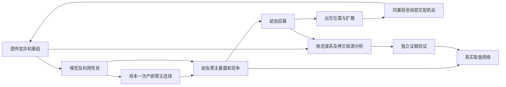

# 植物—昆虫生态与共同演化模型

现行科学版本 **0.1.12**：`slim-qtl-6`、`independent-chemical-2`、
`expression-tuning-contact-3`、`dose-tolerance-lifecycle-2`。
这是用户授权的科学机制修改，不是保持轨迹的重构；[修改论证](ecology_v0.1.12_design.md)
记录旧机制、理由、证据、替代方程与预期后果。旧0.1.11输出须用其冻结源码读取。

## 遗传与功能表型

植物 Zp=(PSM1,PSM2,Z,VOC1,VOC2)，昆虫
Zh=(EI1,EI2,muI1,muI2,EA1,EA2,muA1,muA2,G1raw,G2raw)。
各原发坐标为 clip(background+effect_scale*sum(allele_effects),0,1)，默认背景0、scale=.5。
QTL 的 targets 允许一个位点作用多个坐标，等位效应可以为正或负；不强制任何相关方向。
默认每轴两位点、同轴0/10cM，不同轴独立连锁群；SLiM 5.2原生双亲遗传、
Haldane标记重组与每传递拷贝突变算法保持不变。默认输入只指定独立目标位点。

PSM=(Zp1,Zp2)，VOC=(Zp4,Zp5)，耐受=Zp3。没有PSM到VOC固定映射。
处理能力 I 沿用固定宽度高斯调谐及总表达预算：
Tirk=exp(-(feature_k-muIr)^2/(2*wI^2))，
Iik=sum_r EIr*Tirk/(idle+sum_j Tirj)。I解释为摄入后的有效化学处理表型，
不是直接食物需求、实测酶活或某个P450/GST/UGT基因。
嗅觉模块继续以VOC高斯亲和谱、饱和激活、表达增益和固定神经价性计算效用。
接触响应 G=2*Zh[8:10]-1，为GR介导的综合功能响应，不对应具体GR表达量。

## 时间、空间与行为顺序

每轮为一个昆虫世代，植物世代重叠。周期网格、局部配偶、出生地扩散、
植物全局幸存非自身父本、空位建立及预设昆虫兼容池保持原规则。

1. 当前成虫局部交配并生成潜在卵。
2. 每卵抽取局部空间候选，按VOC嗅觉效用选择尚未检查的植物。
3. 接触后以 sigmoid(intercept+slope*sum_k Gk*PSMk) 接受；拒绝后移除该候选继续搜索。
   最多接触候选数次。outside模式允许嗅觉外部选项终止本卵搜索，forced移除该选项，
   仍执行接触接受。后代实际处理与存活不参与母虫决策。
4. 成功卵抽父本，经SLiM遗传；子代以自身处理能力经历共同取食窗口。
5. 抽幼虫存活、性别与成年传播；植物按实际取食损伤抽存活。
6. 幸存植物按Z恢复叶片，以恢复后资源及合成成本生成传播子；空间空位抽签后才生成植物基因型。
7. 拼接幸存旧株及新株、补充成虫；全部检查完成后原子提交。

新行为需要新增随机抽样，因此不要求跨0.1.11/0.1.12轨迹相同。
随机流种子派生、阶段边界、固定种子重复和失败回滚保持；SLiM核心脚本不改。

## 实际摄入、化学暴露与幼虫存活

每只成功产卵幼虫的实际食物需求 d_i=dmax_i，与PSM和I无关。
同株需求 T_p=sum_i d_i，gamma_p=min(1,B_before/T_p)（无需求时1），
x_i=gamma_p*d_i，g_i=x_i/dmax_i。按原比例分配器执行含舍入预算纠偏的同时分享。
没有额外干扰竞争、补偿取食、捕食者或微生物过程。

每PSM轴独立记录：

- dose_ik=x_i*PSM_pk*dose_scale_k；
- capacity_ik=I_ik*processing_scale_k；
- processed_ik=min(dose_ik,capacity_ik)；
- residual_ik=dose_ik-processed_ik；
- antinutrient_ik=dose_ik。

营养存活 N_i=g_i^nutrition_exponent，零摄入定义N_i=0；
毒性分量 T_i=exp(-sum_k toxicity_weights_k*residual_ik)；
抗营养分量 A_i=exp(-sum_k antinutrition_weights_k*antinutrient_ik)。
总存活 S_i=N_i*T_i*A_i，每幼虫仍只抽一次Bernoulli。
本版抗营养影响独立于处理，处理能力不消除抗营养负荷。
它是明确的理论假设，可分别关闭毒性、抗营养，或在正摄入时用指数0移除营养限制。
没有再次乘母体成本、没有隐含存活底值。

变量均有显式配置换算：PSM为归一化浓度，x为可食干生物量；dose/capacity为
同一抽象化学负荷单位，权重为该负荷的倒数。它们不代表实测分子剂量或酶动力学。
[Kaplan等2014](https://doi.org/10.1371/journal.pone.0093714)支持区分摄入、增长和转化终点；
[Rayapuram与Baldwin 2006](https://doi.org/10.1111/j.1365-3040.2006.01534.x)提供营养指标案例。
这些研究不确定本项目参数或指数乘积方程。

## 植物损伤、耐受、恢复与繁殖

B_post=B_before-X，实际 defoliation=X/B_before；B_before=0 时为0。
植物存活 S_P=exp(-mu0-muD*defoliation)，背景死亡保留。
低初始资源不是取食损伤，不再以1-B_post/K代替defoliation。

r_p=resource_recovery_rate+tolerance_recovery_rate*Z_p，
B_recovered=K-(K-B_post)*exp(-r_p)。高Z提高恢复，既不改变PSM，也不直接降低死亡。
资源恢复只在幸存后实现；恢复后资源用于幸存株的条件繁殖均值：
lambda_P*max(0,1-C_P)*B_recovered/K。

C_P=plant_cost*sum(PSM)+voc_cost*sum(VOC)，Z没有自动固定成本。
C_H=insect_cost*sum(EI)+sensory_cost*sum(EA)，只折减母源卵均值，
不再额外按已处理负荷收费。线性表达/合成成本是可配置理论假设，不是生理定律。
新株仍以 newborn_resource_fraction*K 建立，资源容量、背景死亡、空位抽签不变。
恢复与新株资源为显式系统输入，不追踪根储备、全株碳预算、光水养分或复杂年龄状态。

耐受概念参考[Strauss与Agrawal 1999](https://doi.org/10.1016/S0169-5347(98)01576-6)，
Z线性恢复率、无固定成本、恢复时序和参数值是本项目假设；不保证长期共存、专化或成种。

## 记录与独立验证

`plants.csv`区分取食前、后、恢复后资源和Z、有效恢复率；
`larvae.csv/events.csv`记录两轴全部化学负荷及三项存活分量；
`oviposition.csv`记录有序接触植物、接受概率和结果。审计只读取配置和已记录数据，
独立重建新方程与随机抽样，不调用生产生物计算函数。

历史列 q 和 reference_q 在新版本表示足量食物、无竞争下的化学存活测定，
不再是需求乘子。参考 p 是等机会面板中第一次嗅觉接近概率乘接触接受概率，
不等于多次重试后最终产卵分布。所有新解释由metadata及新协议标识限定。
分析不改变原始数据；旧版本的同名列按旧定义读取。

## 9. 寄主分化、隔离与谱系网络

箭头为可审查的因果假设或分析依赖，并非保证方向。谱系识别与物种验证为只读分析，不反馈行为。

| 来源或参数 | 分类 | 地位与敏感性 |
|---|---|---|
| 同池局部均匀父本抽样、一次产卵选择、幼虫摄入和招募 | 项目现行规则 | 固定基线；交配、扩散半径和资源竞争可预先做敏感性分析 |
| 双亲减数分裂；同轴 0、10 cM、轴间独立 | 项目现行遗传假设 | 非真实染色体；图谱及突变率为预先设定变量 |
| 随机结合下 D′ 经重组乘 (1−r) | 经典理论 | 仅限 C 所列假设；r 为分析变量 |
| 匹配机会空间对照、祖源占比、网络映射 | 项目操作性定义 | 母本权重、分类覆盖、窗口与规模需事先声明 |
| [Nosil 2024](https://doi.org/10.1038/s41467-024-46294-9)、[Linn 2003](https://doi.org/10.1073/pnas.1635049100) | 实证机制 | 空间与气味案例，类群特异 |
| [Linn 2004](https://doi.org/10.1073/pnas.0408255101)、[Eyres 2025](https://doi.org/10.1111/mec.17795) | 实证机制 | 杂交气味响应及蚜虫多 QTL，不等于必有杂交死亡或多效性 |
| [Felsenstein 1981](https://doi.org/10.1111/j.1558-5646.1981.tb04864.x)、[Hawthorne & Via 2001](https://doi.org/10.1038/35091062) | 理论及实证 | 重组障碍和蚜虫连锁案例，不保证本模型成种 |
| [Sobel & Chen 2014](https://doi.org/10.1111/evo.12362)、[Singhal 2025](https://doi.org/10.1146/annurev-ecolsys-102723-055311)、[Maliet 2020](https://doi.org/10.1111/ele.13592) | 方法与理论背景 | 机会校正、独立验证和网络模型；具体指标为本项目定义 |

可模拟并分析寄主暴露、空间机会、实际招募和已记录 QTL 拷贝传递；不能仅由聚类声称物种、全基因组祖源、内源杂交不育或网络稳定性。共同环境与反事实若现有数据不支持，须标记不可估计；持续隔离不足时保留理论缺口。

文献核查范围：Felsenstein 1981、Hawthorne 与 Via 2001、Maliet 等 2020 本次仅核对书目或摘要，未读取全文；其余文献核查相关全文部分。

实施范围：匹配空间机会、固定参考代 QTL 拷贝祖源及网络观察已有最小实现。B 的受控实验执行器、特定杂交队列留存和物种独立性验证仍待实施；当前任务见[项目入口](../README.md#current-work)。

## A｜空间交配机会与交配前隔离

**项目操作性定义。** 在繁殖轮次 t、父本抽取前，按当代可得遗传信息确定互斥候选群 A、B，未知另列；出生寄主 H 是生态标签，不能代替群体身份。每只 A 雌虫 i 的局部集合 Cᵢ 是其交配半径内、同既有兼容池的可用雄虫；全局集合 Uᵢ 是同一兼容池全部可用雄虫，仅移除距离限制，绝不跨池。雄虫按现有规则均匀、有放回抽取。

为保持原抽样分布，选择同一完整分类风险集 I={i∈A: |Cᵢ|>0，且 Uᵢ 全部雄虫身份已知}，令 Cᵢ′=Cᵢ、Uᵢ′=Uᵢ。固定相同母本集合和非负权重 wᵢ，计算；另报告排除的母本及其权重、局部与全局未知雄虫比例。不能分别删掉未知雄虫后各自重新归一。

\[P_L=\frac{\sum_{i\in I}w_i |C_i'\cap B|/|C_i'|}{\sum_{i\in I}w_i},\quad P_G=\frac{\sum_{i\in I}w_i |U_i'\cap B|/|U_i'|}{\sum_{i\in I}w_i},\quad RI=1-P_L/P_G.\]

均为无量纲条件比例，时点是 t 父本抽取前；权重可分别采用母本潜在卵均值（卵/轮次）、实际抽到的潜在卵数（卵）或实际成功产卵数（卵）。实际潜在卵仅在现有局部有配偶时生成，须说明其条件化；成功产卵权重只解释为对成功产卵者的条件效应，不能代表全部雌虫。三种口径不混合，且每个局部/全局比较内使用同一权重。权重和为零、I 为空或 P_G=0 时 RI 为 NA；P_L、P_G 本身分母为零也为 NA。RI 可以为负。无本地候选雄虫及仅有未知身份雄虫各以母本数、可预先定义的潜在繁殖权重占比单独报告：前者是机会损失，不计为群内配对。完整分类筛选改变目标总体，不代表未知个体的交配结构；可补充全体可用雄虫的覆盖率。固定观测权重是静态对照，不能宣称改变空间后生态反馈的总因果效应。B 母本反向指标另算。

例：两个同池雄虫 A、B，各雌局部均能接触两者，则 P_L=P_G=1/2，RI=0。若 A 雌只能接触 A 雄而全局仍各一只，则 P_L=0、P_G=1/2、RI=1；若全局没有 B 雄，P_G=0，RI=NA。均匀植物分布不保证均匀昆虫分布；聚集可增强或减弱局部差异，扩散或交配半径增大通常扩大可达范围，但实际概率取决于空间构型，非单调定律。出生地点和扩散塑造位置，无需第二次寄主选择；这不是性隔离或成种证明。[Nosil 等 2024](https://doi.org/10.1038/s41467-024-46294-9) 区分栖息地与性隔离；[Linn 等 2003](https://doi.org/10.1073/pnas.1635049100) 的果味识别证据针对实蝇。

## B｜共同环境与生态性合子后表现

**项目操作性定义。** 配对方向 X♀×Y♂ 的亲本在交配前按预先确定的群体抽样，现有双亲减数分裂及重组产生后代基因型分布 M(X,Y)。在预先固定的寄主 e、资源量、竞争者组成与密度和测量窗口下，定义 Wₑ(g)=该基因型幼虫从成功产卵至成年招募的条件概率，取值 [0,1]；

\[W_{XY,e}=E_{g\sim M(X,Y)}[W_e(g)].\]

它是无量纲每个成功产卵后代的平均招募概率，分母为该方向在该共同条件下的成功卵数；无卵、无可评估后代或未观测共同环境为 NA。共同环境需要受控试验或明确的反事实计算及支持条件，不能把自然状态下不同竞争直接当作可比结果。模型中的幼虫摄入及存活受其利用性状、植物资源及竞争影响；母本嗅觉影响产卵位置，不是幼虫生存函数。若使用实际产卵到成虫的自然结果，明确另报其寄主暴露分布和分母；无法仅凭观察区分环境与基因型效应。终生遗传贡献是不同终点，不能与招募概率相加。

比较 W_AA,e、W_AB,e、W_BA,e、W_BB,e；方向可通过母本分布和实际暴露不同而非对称。F1 来自 A×B，F2 来自 F1×F1，回交为 F1×A 或 F1×B；均重新定义亲本分布和同一环境，不把它们当同一代。新版本的共同环境表现须按上述营养、残余毒性和抗营养分量重新估计；旧版min(I/D)解析例不适用于现行协议。不预设杂交优势或劣势。

**文献支持的机制。** [Linn 等 2004](https://doi.org/10.1073/pnas.0408255101) 报告实蝇杂交后代对亲本果味响应下降，不能直接证明存活或繁殖下降。[Eyres 等 2025](https://doi.org/10.1111/mec.17795) 的蚜虫 F2 寄主接受与存活涉及多个 QTL，不证明同一基因多效性。环境依赖的招募差异可描述为外源生态隔离的候选证据；当前模型没有专门的 Dobzhansky–Muller 不相容或内源杂交不育机制，也不加入杂交死亡系数。

## C｜选择、重组与基因流

**经典理论，解析工具。** 假定二倍体无限大、随机结合、两个二等位位点、离散世代，且本式不含突变、迁移及抽样漂变。A/a 影响寄主偏好，B/b 影响利用；四种单倍型频率 x_AB、x_Ab、x_aB、x_ab 非负且和为一，p_A=x_AB+x_Ab，p_B=x_AB+x_aB，D=x_AB−p_Ap_B。设有序二倍体 ij 的相对适合度 w_ij≥0，平均适合度 W̄=Σᵢⱼxᵢxⱼwᵢⱼ>0。选择后有序二倍体频率 f*ᵢⱼ=xᵢxⱼwᵢⱼ/W̄；其单倍型边际 x*ᵢ=Σⱼ(f*ᵢⱼ+f*ⱼᵢ)/2。定义 D*ₘₐᵣg=x*AB−p*A p*B，以及双杂合相位差

\[\Delta^*=\tfrac12(f^*_{AB,ab}+f^*_{ab,AB}-f^*_{Ab,aB}-f^*_{aB,Ab}).\]

不假定选择后的配对仍随机，减数分裂后配子频率为

\[x^{next}_{AB}=x^*_{AB}-r\Delta^*,\quad x^{next}_{Ab}=x^*_{Ab}+r\Delta^*,\quad x^{next}_{aB}=x^*_{aB}+r\Delta^*,\quad x^{next}_{ab}=x^*_{ab}-r\Delta^*,\quad D_{next}=D^*_{marg}-r\Delta^*.\]

只有额外假定重组前 f*ᵢⱼ=x*ᵢx*ⱼ（例如单倍型选择之后重新随机结合），才有 Δ*=D*ₘₐᵣg，从而 D_next=(1−r)D*ₘₐᵣg。例：选择后仅有 AB/ab 双杂合体，两方向各 1/2，x*AB=x*ab=1/2，D*ₘₐᵣg=1/4，Δ*=1/2；r=1/2 时 D_next=0，而误用 (1−r)D*=1/8。若选择后重新随机结合且 x*AB=x*ab=0.4、x*Ab=x*aB=0.1，则 D*=0.15，r=0.5 后 D_next=0.075。

频率和 D 无量纲，时点分别为选择后及重组后；W̄=0 则后续频率未定义。选择可因非加性适合度与寄主相关暴露不断重建关联；重组前随机结合时自由重组将已有 LD 减半，但不能单独断言最终 D=0；任意选择后的重组效应取决于双杂合相位频率。迁移混合本身也可能产生 LD：D_mix=ΣⱼqⱼDⱼ+Cov_q(p_A,j,p_B,j)，其中 qⱼ 为混合权重；空间、漂变、迁移、多 QTL 使上式不是完整 IBM 世代方程。

现有不同性状轴连锁群独立，同轴标记 0、10 cM；故跨嗅觉/利用轴自由重组，选择仍可能维持分化，但不保证独立谱系。理论扩展：同染色体标记距离 d Morgan 在 Haldane 无干扰假设下 r=(1−exp(−2d))/2，1 cM=0.01 Morgan；物理连锁不必然是因果基因连锁。多效性是同一遗传变异影响两性状，聚集 QTL 本身不证明多效性；两者均未在此提议加入模型。

**项目概念条件。** 寄主间有效迁移是实际传递并在后代持续的贡献，不是一次跨群配对。分化选择产生的组间差异须足以抵消重组、混合和漂变的作用；无普适阈值。若偏好不改变寄主暴露，适合度无寄主特异性且持续自由混合，在无其他分化驱动力下，仅有标签不能维持稳定寄主分化。若现有机制不能维持隔离，应记录缺口，另立问题，不以群标签强加隔离。[Felsenstein 1981](https://doi.org/10.1111/j.1558-5646.1981.tb04864.x) 的全文本次未获取，仅核对书目与摘要；[Hawthorne 与 Via 2001](https://doi.org/10.1038/35091062) 给出蚜虫 QTL 连锁实例。

## D｜有效流动与候选谱系

**项目操作性定义。** 在 t 父本抽取前固定互斥群 A、B 和 unknown；出生寄主 H(P1)/H(P2) 为独立标签。对同兼容池、身份已知且有局部候选雄虫的 A 母本成功卵，逐卵记录父本。令 E_AB 为 B 雄所受精卵数、E_A 为所有已知父本的 A 母本成功卵数，F_mating(A♀×B♂)=E_AB/E_A；此为实际抽父本比例，须与同母本、同权重的 A 文档局部/全局机会基线并报，非单靠原始数量校正。没有成功卵时 NA；无配偶母本机会损失另报。反向 B♀×A♂ 单独计算。

令 O 为 t 成功卵形成的出生后代，R⊆O 为招募成虫。双亲各半计：F_birth(B♀×A♂)=Σₒ∈O 1[m∈B]1[f∈A]/(2|O|)，F_recruit(B♀×A♂)=Σₒ∈R 1[m∈B]1[f∈A]/(2|O|)。均为每个总出生后代的已确认 B♀×A♂ 父源贡献，故可跨阶段比较，分母是含 unknown 的同一出生队列。它们是该方向真实份额的下界；另按相同阶段及分母报告亲本至少一方未分类、且已知身份不排除该方向的配对数的一半，作为上界增量。已知身份不匹配者不能计入未知增量。F_mating 的分母则条件化于已知父本，不能直接与这两个份额互换；无出生时 NA，已出生但零招募则 F_recruit=0。母源方向 B♀×A♂ 与 A♀×B♂ 分开，若研究 A 任一亲本跨群贡献需另列双方向，避免重复或混淆。此账本是双亲角色份额，并非特定位点实际传递。

在锚定时点 t 为每个已知群体亲本的每个位点两份拷贝赋 A 祖源指示，未知赋 NA；逐代用 gamete_transmissions 的 parent_id、role、locus_id、transmitted_homolog_before_mutation 回溯实际来源，新突变保留其来源谱系并单独标注突变。对于 t+k 的个体 i，以全部 2L 个观测 QTL 拷贝为分母，aᵢᴬ=nᵢᴬ/(2L)，uᵢ=nᵢunknown/(2L)，分别表示确认 A 来源份额和未知份额；其余已知来源单独计数，份额和为一。L=0 或拷贝总数不可确定时 NA，不把未知归为非 A。预先固定基于不使用 A 祖源指标的当代遗传特征及匹配规则，将 t+k 个体映射到参考群 B，混合或不能可靠匹配者列 unknown；若规则依赖 A 祖源则存在选择偏差，不能把下式解释为迁移。

\[G_{A\to B}^{(k)}=\frac{\sum_{i\in B(t+k)}a_i^A}{N_B(t+k)},\quad U_B^{(k)}=\frac{\sum_{i\in B(t+k)}u_i}{N_B(t+k)}.\]

均无量纲，空群 NA；G 是确认份额，未知存在时真实份额范围为 [G,G+U]。k=0 时以锚定时点相同规则计算基线；若 A/B 互斥且锚定 B 的全部拷贝标为 B，则 G(0)=0，不能将之后全部 A 份额直接解释为每代迁移率。未来可另定义 F_persist(k)：指定跨群出生队列后代传递来源的已确认 QTL 拷贝占目标群全部 2L 拷贝比例，未知份额另报；空分母或无法识别队列来源时 NA。本轮最小实现仅追踪参考代来源份额，不实现特定跨群出生队列的 F_persist。历史锚定及逐代传递完整时才能追踪；仅限观测 QTL 拷贝，不是全基因组祖源，也不是 Nₑm。亲本群 ID 不等于实际等位传递。

例：4 个出生中两枚 B♀×A♂，其中一枚招募，则 F_birth=2/8=0.25、F_recruit=1/8=0.125；父本抽取比例还依赖 B 母本已知父本卵总数。顺序屏障应以共同参考路径的条件成功概率连乘，再与匹配基线比较，不可直接相加 RI。[Sobel 与 Chen 2014](https://doi.org/10.1111/evo.12362) 的等比例基线 RI=1−2H/(H+C)，H、C 为机会匹配的异群和同群成功量；不等比例须使用对应非对称基线，原始计数不能直接套用。

候选发现与验证分开：预先声明观察窗口、最小样本、聚类稳定性及未知处理；重叠或不稳定者标 uncertain。遗传差异、持续有效流动、跨代独立性与寄主差异分别给证据及不确定性；不得仅凭单项证据或候选聚类定物种，证据不足时保留 uncertain，寄主差异并非物种必要条件。持续、split、fusion 是观测身份对应事件，消失须区分真实灭绝、采样不足及计算停止。标签不改变个体相容或行为。[Singhal 等 2025](https://doi.org/10.1146/annurev-ecolsys-102723-055311) 区分候选发现与独立验证。

## E｜从观测身份到互作网络

**项目操作性定义。** 每轮 t 分别形成生态群网络（现有兼容池/出生寄主）、候选谱系网络、经预声明多证据支持并附不确定性的候选物种网络。zᵢ(t) 使用取食时已可得信息固定：在线网络不可未标注地以未来信息重写；允许标记 retrospective 的回顾网络。候选聚类不是物种，也不改变模拟行为。母本来源身份可用于全部幼虫；若用幼虫自身遗传身份，必须覆盖死亡幼虫，缺失置 unknown，不能只用成年聚类。

对 t 轮真实取食幼虫 i、植物 j，xᵢⱼ≥0 是实际消耗资源量，a、b 为同一映射下的昆虫及植物节点：

\[W_{ab}(t)=\sum_{i,j}1[z_i(t)=a]1[z_j(t)=b]x_{ij}(t).\]

单位为资源量/轮次，包含死亡与存活幼虫、unknown/unassigned；映射互斥且穷尽时 ΣₐᵦWₐᵦ=Σᵢⱼxᵢⱼ。无消费是零，未记录轮次是 NA。产卵数（卵/轮次）及招募数（个体/轮次）另建网络，不与资源量相加；植物及幼虫节点时点和来源必须一致。现有 maternal_source 网络是母本群到植物群的消费账本，不等同幼虫遗传群；recruit_cluster 仅记录幸存补充数。

手算：一个原节点对 P1、P2 消耗 3、2，总量 5。split_candidate 后两个候选节点分别 (2,1)、(1,1)，候选层总量仍 5，物种层仍 (3,2)；只有独立性获支持时才可在候选物种层拆分，非自动认证。fusion 时本轮两候选身份合并，权重相加 (3,2)，既往节点和连边保留并记录对应关系与混合祖源；这是观测身份融合，不必证明生物种融合。extinction 若确认无存活且无继续繁殖成员，未来轮次移除节点，保留历史；若仅分群消失或数据缺失则 uncertain。uncertain 不强拆，保留原节点或 unknown，给范围并保持总量。死亡幼虫的消费也包含在这 5 中。

不成种时同样更新寄主转换及连边权重。可报告节点丰富度、正权连边数、节点强度、明确算法的专化和模块度及代际变化；空网络、零总权或算法不可定义时 NA。丰富度及模块度不是稳定性；扰动恢复率、持久性与灭绝稳健性需另立操作定义。[Maliet 等 2020](https://doi.org/10.1111/ele.13592) 提供生态演化 IBM 网络背景，[Singhal 等 2025](https://doi.org/10.1146/annurev-ecolsys-102723-055311) 提醒独立验证物种边界。
