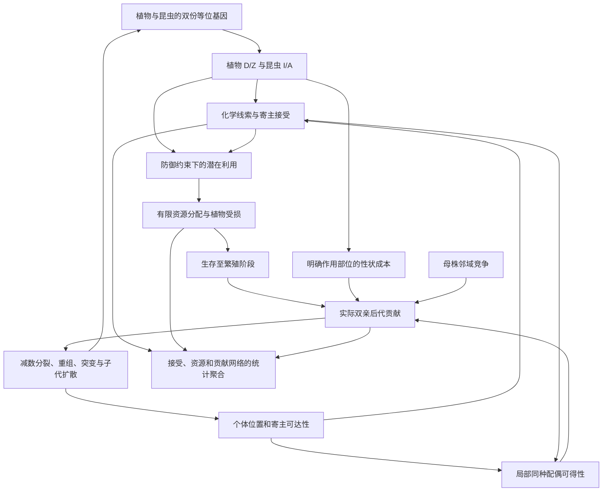

# v0.1.2：寄主关系形成的最小可检验模型规范

本规范对应 `model_version: 0.1.2`、遗传协议 `sexual-qtl-1`。完整方程见 [model.md](model.md)，修改动机与文献核验范围见 [原计划](v0.1.2_plan.md)。本版增加可追溯观测和受控比较，不增加成种机制，不以专化、共存或稳定为验收条件。

**当前优先级（2026-10-25）：先完成 IBM 理论架构定稿，再安排正式机制实验。** 第 1–8 节描述当前实现；新增第 9 节是架构决策草案，建议不表示已经修改代码。通过测试只证明实现与规则一致，不证明规则本身具有充分生物学依据。

## 1. 生物学对象与一代的顺序

昆虫是**具有繁殖前自主寄主选择与取食阶段的抽象植食性昆虫**，配置名为 `self_feeding_pre_reproductive`。当代个体选择植物、取食、生存，在实际寄主相关位置寻找同种配偶，随后产生和扩散后代。后代从母体当代寄主附近扩散；这不表示后代已经在该寄主上发育。模型没有母虫产卵决策、卵—幼虫—蛹—成虫或成虫再飞行阶段。

植物为二倍体、两性花、严格异交；昆虫为二倍体、雌雄异体。物种边界外部给定，只允许同种交配。亲代在繁殖后全部退出。记录代 `t` 的生态和亲本，记录代 `t+1` 的实际子代；终代只观察，不产生下一代。

## 2. 遗传对象与可解释边界

植物 QTL 经加性映射产生防御 D 和独立化学线索 Z；昆虫产生标准化处理预算 I 和识别模板 A。V 由 `clip[rho B D + (1-rho) Z]` 产生，参与已相遇候选之间的选择，**不决定远距离发现**。QTL 是抽象效应位点，不是已校准的 TPS、OR 或 CYP。

二倍体双亲分别形成配子；独立连锁群自由组合，群内 Haldane–Poisson 重组，逐传递拷贝产生新等位基因。改变连锁图谱不自动产生创始连锁不平衡；改变 `rho` 是表型映射干预，不是连锁干预。关闭突变仍允许选择、分离、重组和漂变。

裁剪前性状为 `T_raw = background + effect_scale × 两份拷贝效应总和`。逐坐标的突变均值、方差为：

\[
E[\Delta T_k]=2s_e\sum_\ell\mu_\ell m_{\ell k},\quad
V_{M,k}=2s_e^2\sum_\ell[\mu_\ell\sigma_{\ell k}^2+\mu_\ell(1-\mu_\ell)m_{\ell k}^2].
\]

这假定各拷贝和位点独立突变，描述**给定传递等位基因的新增效应**，不包括亲本分离方差，也不等于裁剪后的表型方差。关闭某类群突变时其新增输入为零。裁剪边界比例需另报。

## 3. 取食预算与量纲

设单位食物中的毒素质量 `c_pj = C_j^0 D_pj`，一个固定取食窗口内可处理的总毒素量 `U_ij = C_j^0 dmax_i I_ij`。约束 `d c_pj ≤ U_ij` 与 `d ≤ dmax_i` 推导出：

\[
q_{ip}=\min(1,\min_{j:D_{pj}>0}I_{ij}/D_{pj}),\qquad d_{ip}=d_i^{max}q_{ip}.
\]

全部 D 为零时 q=1；正 D 通道对应 I=0 时 q=0。I 是**相对于自身最大食物需求的标准化处理预算**；固定 I 而改变 dmax 同时改变绝对预算 U，不能声称只改变需求而绝对解毒能力不变。

此最限制通道形式有 Speed 等（2015，DOI: [10.1111/nph.13560](https://doi.org/10.1111/nph.13560)）的理论模型先例，不是普适生化定律。上述单位推导是本项目定义。毒素均匀、通道不补偿、不包含协同/拮抗均为明确假设。

对同株植物竞争，`gamma_p=min(1,R_p/sum(d))`，零总需求时 gamma=1；实际摄入 `x_i=gamma_p d_i`，满足率 `g_i=x_i/dmax_i`。R、dmax、d、x 使用同一可食干物质量单位和同一繁殖前窗口，满足 `0≤g≤q≤1`、`sum(x)≤R`。无寄主时 q 未定义，d、x、g 为零。比例资源分配是独立的对称竞争假设。

## 4. 生存、成本与实际贡献

植物 `S=sP0+(1-sP0)(1-h)`，昆虫 `S=g`。植物 `F=max(0,1-c_D sum(D)-c_V mean(V))`，昆虫 `F=max(0,1-c_I sum(I))`。

F 连续降低**母源后代生产均值**：合格母本的 Poisson 均值为植物 `lambda F phi`、昆虫 `lambda F`。父本先满足存活、同种、位置、角色和 `F>0`，然后均匀抽样。没有再乘 F 的父本权重，也不重复施加生存惩罚。父本 `F>0` 是独立且未经直接实证支持的门槛假设。

在默认两个维度、性状和 V 位于 [0,1] 时，植物 F≥0.70、昆虫 F≥0.75，门槛不能触发。更广成本域可触发；若结论依赖此门槛，需要另行论证父本过程，不能用默认域内不触发代替该论证。

`W_i`、`W_insect` 等既有 `S×F` 字段只是**生态—繁殖表现代理量**，不是完整适合度。实际一代贡献直接从双亲子代记录计数：

\[
w_i^G=(B_i^m+B_i^f)/2,\qquad \sum_{i\in s}w_i^G=N_{s,t+1}.
\]

植物可同时贡献种子与花粉，昆虫按雌雄角色贡献。全体当代个体进入无条件统计，失败个体贡献为零；成功者条件均值另报。只有完成代际提交才有实际贡献；终代或失败更新的贡献是缺失，不是零。

母源后代期望对所有植物和所有雌虫计算，包括没有寄主的雌虫（零期望）；雄虫的母源期望记缺失。全体昆虫的母源期望均值将雄虫按零贡献计入，另报全体雌虫均值及母源角色数量，避免分母混用。

对某位点等位基因，`z_i=拷贝数/2`，在有后代时：

\[
\widetilde p_{t+1}=\frac{\sum_iw_i^Gz_i}{\sum_iw_i^G},\quad
p_{t+1}-p_t=(\widetilde p_{t+1}-p_t)+(p_{t+1}-\widetilde p_{t+1}).
\]

第一项包含选择与随机繁殖差异，第二项包含分离抽样与突变等传递偏离，不能分别命名为“纯选择”和“纯突变”。无后代时下一代频率、加权频率和分解为缺失；消失等位基因在非空后代中的频率才是零。

## 5. 固定面板的个体联合反应

固定参考 D/Z 面板按相同规则生成 V。每只昆虫在等可得面板上的条件选择概率 p 不含外部拒绝选项，q 是无限资源利用上限。先对同一个体相乘再求均值：

\[
J_{hp}=\overline{p_{ip}q_{ip}}=\bar p_{hp}\bar q_{hp}+\operatorname{Cov}_{N_h}(p,q).
\]

协方差与方差使用总体分母 N。个体 p/q 矩阵随快照保存，汇总输出 J、协方差及 p、q、pq 方差，能复原分布。空物种所有这些统计为缺失。J 不是生态实际摄入、绝对接受概率、后代数或终生适合度。

## 6. 分层网络及关系判读

- **相遇层**：候选抽样曝光；与抽样前所有空间可达植物、绝对丰度分开。
- **接受层**：实际选择次数；未选中的候选不逐一计为拒绝，拒绝指整个候选集合的外部选项。
- **资源层**：`Q_hp=sum(x_i)`，并报告昆虫物种内资源份额；总资源流零时份额缺失。
- **贡献层**：母源后代归母本当代寄主，父源后代归父本当代寄主；合并时两者各乘 1/2。父母不同寄主时分别计入，不能全部归给母本或子代落点。

每层同时保留绝对值与分母，不将低总量下的高份额解释为强关系。网络边来自个体过程，不反过来以模块度、专化或稳定性奖励个体。

“形成”必须注明关系层、初始状态和持续窗口；“转换”区分丰度/空间机会与固定面板反应变化；“稳定”只对声明窗口、扰动和重复成立，不等于演化稳定策略。每条边无需单独维持整个人口。2P×2H 只能检查多个固定物种间的机制通用性，不足以支持复杂拓扑或成种结论。

## 7. 对原计划的实施修正

1. **复用亲本账本，不重建第二套出生过程。** 贡献从已有双亲计数派生，并区分抽样与提交。
2. **完整重标记不要求同 seed 逐轨迹相同。** 现有随机流绑定物种序号；检查输入置换、确定性函数一致性及小样本描述，不将有限重复当作分布等价证明。
3. **对称输入不等于有限样本严格无偏。** 较少预设场景保留非零变异，报告 p/q/J 的实际分布与支持范围；不筛选种子直到对称，也不追调参数直到形成专化。
4. **独立/连锁使用同一组 I/A 位点对检查创始关联。** 不能把独立图谱没有群内单倍型表误判为样本关联为零。
5. **零代诊断不是繁殖反事实。** 不再把同时忽略受损与配偶限制的 `lambda F phi` 命名为“仅去除植食损伤后的期望”。双向检查另外执行一代固定焦点基因型的干预。
6. **短程核对不证明共同演化。** 对方组成影响一代相对贡献只是路径检查；共同演化、稳定、专化和成本的普遍作用需要更充分的重复、参数依据和双方可遗传响应证据。

## 8. 证据使用

生活史区分、偏好与表现及遗传关联对照沿用原计划 R2、R3、R8、R9；取食预算先例见 R1，实际贡献背景见 R5，突变尺度背景见 R6。计数、J 和频率分解是本项目数学定义，不伪称文献原公式。参数仍为归一化约定或探索性数值，不升级为经验估计。原审查报告保留历史身份，未决的父本成本过程、化学功能校准和成种机制并未因本次实现而解决。

## 9. 理论架构定稿：决策草案，尚未更改生成规则

### 9.1 先规定模型的解释层次

建议基础模型定位为：**具有抽象二倍体遗传和功能性状、寄主相关空间互作、非重叠世代的机制型 IBM**。它从遗传差异出发，通过个体生态过程产生差异性遗传贡献。它不是已校准的具体昆虫—植物系统，也不是分子反应模型。

理论定稿需要逐项说明实体、状态、时间尺度、过程顺序、个体可获得的信息、相互作用、随机性和输出。这符合 ODD 的模型描述要求；ODD 提供透明描述的方法，不替任何生物假设背书。[Grimm et al. 2020，DOI: 10.18564/jasss.4259](https://doi.org/10.18564/jasss.4259)

建议采用以下因果顺序，而不是“性状先确定一个总适合度，再由适合度决定物种互作”：

图中的网络是观测结果。网络变化的反馈通过具体个体、丰度、资源和配偶发生，不由网络指标直接奖励个体。未来谱系分化改变个体集合及交配关系后，也应经这些过程影响网络；IBM 到网络的研究路线有先例，但本模型具体边权仍需自行定义。[Maliet et al. 2020，DOI: 10.1111/ele.13592](https://doi.org/10.1111/ele.13592)

### 9.2 必须先决定的三项架构问题

#### A. 生命周期：选择者、取食者和繁殖者是谁？

**推荐基础选择：** 保留当代个体自主选择、取食后繁殖的阶段压缩模型，并把一个时间步定义为植物和昆虫各完成一次代际更新的抽象周期。它隐含双方更新节律同步，不能直接映射到任意多年生植物与多世代昆虫系统。

“当代自己取食”和“母体选产卵寄主、后代获得资源”会改变性状表达阶段、亲子关联和选择作用对象。二者不能靠改名混用。产卵理论及成虫表现研究支持这种区分，而不是证明目前自主取食抽象适用于所有昆虫。[Jaenike 1978，DOI: 10.1016/0040-5809(78)90012-6](https://doi.org/10.1016/0040-5809(78)90012-6)；[Scheirs et al. 2000，DOI: 10.1098/rspb.2000.1250](https://doi.org/10.1098/rspb.2000.1250)

**定稿要求：** 若研究对象仍为抽象自主取食者，可继续使用现有生命过程；若目标转向母体偏好与幼虫表现，则必须先重写生活史规范，不能继续沿用当前繁殖归属解释。当前不必增加所有虫态或成虫飞行细节。

#### B. 成本：减少的是生存、母源后代，还是父源贡献？

当前 F 连续影响母源后代数，但又用 `F>0` 决定父本资格；这并非数学不可计算，而是把连续成本和父本功能阈值放在一起，尚没有充分的共同生物解释。默认阈值不触发，不能消除这项架构问题。

**推荐的最小候选方案：** 将 F 明确限制为母源后代生产成本。若采用这个定义，父本资格只由生存、角色、同种和空间条件决定，不再引用这个母源 F 的零值。该方案需要后续修改当前父本门槛，**本轮没有实施**。

这项建议是从变量作用部位推出的最小模型取舍，不是声称有文献证明父本没有成本。它会忽略性状对雄性/花粉功能的直接成本，只允许通过生态生存和配偶机会影响父源贡献。如果课题要研究一般代谢成本及其对两种繁殖角色的影响，这个简化就不够，应另行论证统一生理预算或角色特异成本；不能直接给父本再乘一个 F。

防御成本的实验证据及线性成本的模型先例，只支持考虑权衡，不能决定当前成本作用在哪种角色。[Züst et al. 2011，DOI: 10.1098/rspb.2010.2475](https://doi.org/10.1098/rspb.2010.2475)；[Speed et al. 2015，DOI: 10.1111/nph.13560](https://doi.org/10.1111/nph.13560)

还需明确 `c_D sum(D)` 与 `c_V mean(V)` 是防御生产和线索释放的两项不同支出，还是对同一化学投入的重复记账。仅有 D→V 的统计耦合不能证明有两笔成本；只有给出不同支出的过程解释，才能同时保留两项。现阶段不能把这两项称为已闭合的碳/能量预算。

#### C. 密度依赖：竞争作用在母株附近，还是子代落点？

实际规则是先按母株邻域竞争计算 `phi`，将其乘入母源后代均值，之后才扩散子代。配置中的 `plant_density_stage: offspring_recruitment` 容易使读者误以为已经模拟子代落点的招募限制；当前没有这一步。

**推荐基础选择：** 保留现有母株邻域对有效后代生产的限制，并统一其名称与解释。不要把它当作显式的落点幼苗建立过程。若之后研究种子扩散—定殖权衡，才考虑把建立过程置于扩散之后；这会改变模型，不能作为简单文字整理。

空间竞争与扩散的作用位置会影响可表达的生态策略，因此过程顺序必须明确。[Bolker & Pacala 1999，DOI: 10.1086/303199](https://doi.org/10.1086/303199) 该文提供空间策略研究依据，不直接验证当前局部 `phi` 公式或要求采用某一种招募规则。

### 9.3 其余机制的保留条件

| 模块 | 建议判断 | 定稿时必须写明的限制 |
| --- | --- | --- |
| 二倍体、双亲遗传、分离和重组 | 保留 | 抽象连锁群不是实测染色体；重组率对应遗传距离，不是物理长度 |
| 加性 QTL 与效应突变 | 保留为基础近似 | 位点数、效应尺度、突变输入及边界共同影响变异；裁剪产生非线性和边界效应，不能称整个映射始终线性 |
| D/Z 到 V 的混合 | 保留为待论证的表型耦合假说 | 不是已经实现的分子功能层；rho 不等于遗传连锁，B 不自动代表酶反应 |
| 空间相遇后按 A/V 选择 | 保留为有限信息行为模型 | 昆虫不能读取未来繁殖成功；V 目前不影响远距离发现 |
| 外部拒绝选项 | 有条件保留 | 每代只有一次选择，无寄主即无法生存繁殖；拒绝不是“稍后再找”。这是强约束，必须与上述抽象生活史一致 |
| 最限制毒素预算与共享资源 | 保留 | q 是资源竞争前的利用上限；I 随自身 dmax 标准化；比例共享是假定对称竞争 |
| `S_H=g`、`S_P=1-(1-sP0)h` | 可保留为最简线性人口学假说 | 给定资源状态后，收益和损伤在本版只直接进入生存；不要无依据地再复制到后代数中；也不声称真实生物只存在这一条路径 |
| Poisson 条件后代数 | 可保留 | 是给定生存、成本和配偶后的随机生产模型；不是对所有个体直接抽后代，不是实测产卵分布 |
| 昆虫在寄主位置附近交配 | 保留但明确为架构假说 | 寄主选择被设计为可以影响配偶接触，不能把这条因果路径的存在称为完全涌现；其产生多强隔离仍是结果 |
| 固定物种竞争矩阵和同种交配 | 仅适用于基础版本 | 同种/异种竞争差异可能预置背景共存条件；物种边界已给定，不能证明新物种产生 |

这些“保留”不是新的经验验证。各模块的已有依据和具体函数的未证实部分，分别见 [model.md 的公式—证据表](model.md) 与 [v0.1.2_plan.md 的参考文献及边界](v0.1.2_plan.md)。

两个需要特别澄清的数学后果：

1. 候选植物具有相同得分 u 时，M 个候选的总接受概率为 `M exp(tau*u)/(exp(outside)+M exp(tau*u))`。可得候选更多会提高总接受概率，这是现有规则的解析后果。因此“是否选择寄主”同时受可得性影响，不能全部归因于遗传偏好。
2. 食物账本守恒 `sum(x)<=R`，不代表植物生长、代谢和子代总生物量也守恒。当前每个新植物获得给定 R，是一个代际资源供给假设；不应为了追求形式完整而立即增加未校准的整个能量模型。

### 9.4 与最终成种和多样性问题的接口

现阶段应固定实体定义，不新增成种阈值。未来研究成种时必须单独区分个体、局地种群、谱系和物种：

- 基因型差异或统计聚类不能自动等于生殖隔离。
- 交配与基因流机制决定隔离如何形成；谱系标签负责记录，不能反过来凭标签制造隔离。
- 新标签不能自动获得新的竞争系数或额外生态位。
- 多样性变化需要明确谱系形成、持续、融合与灭绝的计数规则，不要求植物和昆虫同步成种。

生态分化与交配机制共同产生隔离有明确理论先例，但不存在适用于所有系统的通用性状距离阈值。[Dieckmann & Doebeli 1999，DOI: 10.1038/22521](https://doi.org/10.1038/22521) 本阶段的任务是让基础架构不阻断这条扩展路线，而不是提前实现该论文的成种机制。

### 9.5 理论定稿的完成标准与工作顺序

先完成以下工作，再决定版本编号或正式实验：

1. **确定对象和生命周期。** 写明自主取食模型的适用范围、共同时间步及每个阶段的位置；把不适用的生活史结论排除。
2. **确定性状和预算含义。** 为 D、I、Z、V、A、R、dmax 给出定义、尺度和信息可达性；说明资源守恒只覆盖哪部分过程。
3. **决定成本与竞争的作用位置。** 在 9.2 的候选方案中形成一套一致规则；其中父本成本取舍必须明确标为项目假说，不能伪造直接实证支持。
4. **逐箭头进行理论检查。** 每个性状怎样影响生存或双亲贡献、遗传如何变化、双方怎样互相改变选择环境，都必须有明确过程；删除没有研究目的的独立奖励和重复作用。
5. **把定稿规则映射到实现差异。** 届时只修改必要的公式、阶段名称和数据契约，并做边界、守恒和亲子遗传验证；不以专化、共存或网络形状作为通过条件。

理论定稿允许保留有目的的简化和未校准参数，但不允许变量前后含义变化、文献与假设混写、成本重复记账或模型声称实现了实际上不存在的过程。它是“自洽、透明、适用范围明确”，不是“所有函数都已得到实证证明”。
